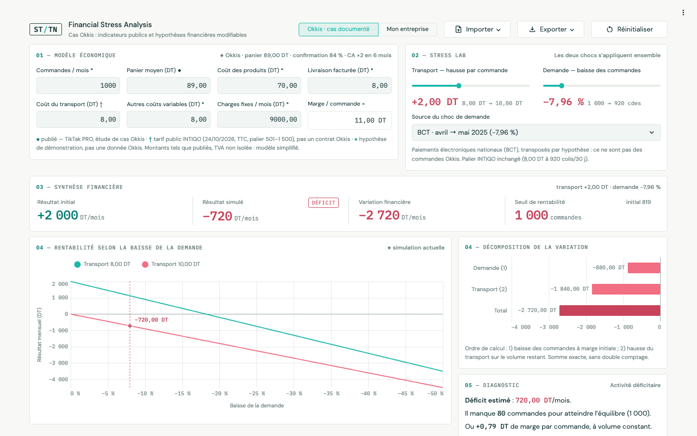

# ST/TN — Startup Stress-Test TN

Laboratoire de résistance économique pour startups e-commerce tunisiennes : que devient le résultat
mensuel si le transport coûte plus cher, si les commandes baissent, ou les deux ?



## Lancer (terminal VS Code, macOS)

```bash
cd ~/Downloads/startup_stress_test_tn_v2
source .venv/bin/activate
python -m pip install -r requirements-dev.txt   # première fois
python -m streamlit run app.py
```

Lancer depuis ce dossier pour appliquer le thème (`.streamlit/config.toml`). Tests : `python -m pytest -q`.

## Ce que l'on voit à l'ouverture : le cas Okkis

| Donnée | Valeur | Statut |
|---|---|---|
| Panier moyen | 89 DT | ◆ publié — [TikTak PRO, étude de cas Okkis](https://tiktakpro.com/blog/etude-de-cas-okkis-mode-tunisie) (TTC/HT non précisé) |
| Taux de confirmation | 84 % | ◆ publié — affiché, **non appliqué** au volume (ce n'est pas un taux de livraison) |
| Chiffre d'affaires | ×2 en six mois | ◆ publié — volumes non communiqués par la marque |
| Coût du transport | 8 DT TTC | † tarif public [INTIGO](https://intigo.net/blog/tarif-livraison-colis-tunisie/) du 24/10/2026, palier 501–1 500 colis/30 j — pas un contrat Okkis |
| Commandes, coût produits, livraison facturée, autres coûts, charges fixes | 1 000 · 70 · 8 · 8 · 9 000 | * hypothèses de démonstration |

Sources vérifiées le 12/11/2026 et enregistrées dans `data/cas_okkis.json` (fonctionne hors ligne).
Le résultat calculé **n'est pas** le bénéfice réel d'Okkis.

Chocs par défaut : transport +2 DT, demande −7,96 % (BCT avril → mai 2025, calculée depuis
`data/bct_paiements_2025_avril_juin.csv` ; paiements électroniques nationaux transposés par hypothèse).

| Scénario | Commandes | Marge | Résultat | Seuil |
|---|---:|---:|---:|---:|
| Initial | 1 000 | 11 DT | +2 000 DT | 819 |
| Transport +2 DT | 1 000 | 9 DT | 0 DT | 1 000 |
| Demande −7,96 % | 920 | 11 DT | +1 120 DT | 819 |
| Deux chocs | 920 | 9 DT | −720 DT | 1 000 |

« Mon entreprise » : cellules vides (rien n'est complété automatiquement) ou import CSV
(`data/entreprise_3_mois_modele.csv`). Les modifications de chaque cas sont conservées.

## Structure

- `app.py` — orchestration : en-tête, 01 Modèle, 02 Stress lab, 03 Synthèse, 04 Graphiques, 05 Diagnostic.
- `finance.py` — moteur de calcul (Decimal). `diagnostic.py` — statut, décomposition exacte, seuils, leviers.
- `data_io.py` — CSV BCT, cas JSON, import, paliers INTIGO. `charts.py` — Altair. `components.py` — HTML.
- `styles.css` — design system ST/TN. `report.py` — export HTML imprimable.
- `tests/` — 64 tests (moteur, régression ShopTN, cas Okkis, données, rapport, application AppTest).

## Limites

Modèle simplifié : TVA non isolée (montants tels que publiés), impôts, retours et amortissements non
modélisés ; le palier INTIGO peut changer avec le volume (signalé, non appliqué automatiquement) ;
les variations BCT ne sont pas des commandes. Les résultats sont conditionnels, pas des prévisions.
